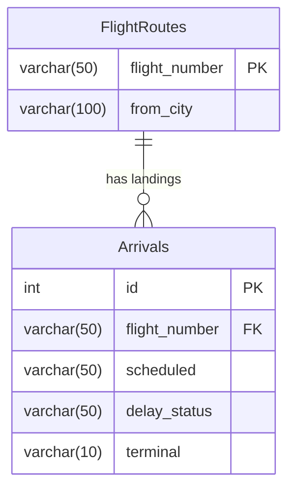

# Flight Arrivals Management System (`JDBC_FlightManager`)

**Course:** Software Engineering Methods (Academic Year 2026–2027)  
**Institution:** Braude College of Engineering | Department of Software Engineering  
**Database Engine:** MySQL 8.0+ | **Language:** Java 25 LTS (JDBC)

---

## 1. Project Description
[Provide a concise overview of the Flight Arrivals Data Access Layer (DAL), CSV ingestion, 3NF relational schema, JDBC operations, and SQL Injection remediation.]

---

## 2. Engineering Team Details (Single-Workstation Driver–Navigator)

| Role | Full Name      | Student ID   | Braude Academic Email         |
| :--- |:---------------|:-------------|:------------------------------|
| **Student A** | Denis Zuravlov | 318547007    | denis.zuravlov@e.braude.ac.il |
| **Student B** | Dvir Klein     | 318931169 | dvir.klein@e.braude.ac.il     |

* **Group Number:** N/A
* **GitHub Repository URL:** https://github.com/DenisZuravlov/JDBC_FlightManager.git

---

## 3. Technology Stack
* **Runtime & JDK:** BellSoft Liberica Full JDK 25 LTS
* **Database Server:** MySQL Server 8.0+ (`FlightDB` schema)
* **JDBC Driver:** MySQL Connector/J 9.5.0 (`mysql-connector-j-9.5.0.jar`)
* **IDE & Database Tooling:** IntelliJ IDEA Ultimate (Built-in Database Console & SQL Generator)
* **Local AI Assistant:** LM Studio (`Qwen2.5-Coder-7B-Instruct`) integrated via the Continue plugin
* **Version Control:** Git & GitHub

---

## 4. Database Normalization (3NF) & Functional Dependencies ($F$)

### 4.1 Functional Dependencies ($F$) in `rawflights`
* $\text{flight} \rightarrow \text{fromC}$: Each flight number uniquely determines its origin city.
* $(\text{scheduled}, \text{flight}) \rightarrow \text{delay}, \text{terminal}, \text{fromC}$: Each scheduled arrival event determines its delay status and terminal.
### 4.2 Why `rawflights` Violated 3NF
`rawflights` violates 3NF because the non-key attribute `fromC` depends on `flight` ($\text{flight} \rightarrow \text{fromC}$), which is not a superkey for arrival logs, creating transitive/partial redundancy:
* **Update Anomaly:** Changing a flight's origin city (`fromC`) requires updating every arrival row for that flight, risking inconsistent data.
* **Insertion Anomaly:** A new flight route (`flight`, `fromC`) cannot be added until it has a scheduled arrival time.
* **Deletion Anomaly:** Deleting the last arrival record for a flight also deletes the knowledge of where that flight originates (`fromC`).
### 4.3 Decomposed 3NF Relational Schema
* **`FlightRoutes` (`flight`, `fromC`)**
    * **Primary Key:** `flight`
    * **Foreign Keys:** None
* **`Arrivals` (`id`, `scheduled`, `flight`, `delay_status`, `terminal`)**
    * **Primary Key:** `id`
    * **Foreign Key:** `flight` references `FlightRoutes(flight)`
---

## 5. Independent AI Prompt (Part 4 – `FlightViewer.java`)

```text
Write a complete Java class named FlightViewer with a main method.
Import all needed libraries (java.sql.* and java.util.Scanner).
At the very start of main, instantiate a single Scanner(System.in), prompt the user for the database password ("root"), and prompt the user for a target Terminal number (valid terminals: 2, 3, 4, 5), reading both with scanner.nextLine().trim() into String variables named password and terminal BEFORE opening the database connection.
Connect to MySQL FlightDB using URL: "jdbc:mysql://localhost:3306/FlightDB?allowLoadLocalInfile=true&allowPublicKeyRetrieval=true&serverTimezone=Asia/Jerusalem&useSSL=false" and user "root".
Always use try-with-resources for Connection and PreparedStatement.
Use a secure PreparedStatement with '?' to execute this exact SQL query:
"SELECT Arrivals.id, Arrivals.flight_number, FlightRoutes.from_city, Arrivals.scheduled, Arrivals.delay_status, Arrivals.terminal FROM Arrivals INNER JOIN FlightRoutes ON Arrivals.flight_number = FlightRoutes.flight_number WHERE Arrivals.terminal = ? ORDER BY Arrivals.scheduled ASC"
CRITICAL: Bind the parameter using pstmt.setString(1, terminal) (since terminal is VARCHAR(10)).
Execute the query inside a try-with-resources ResultSet block and print the output as a clean, well-aligned ASCII table:
1. Define a format string: "%-5s | %-10s | %-18s | %-10s | %-18s | %-8s%n" and a horizontal divider line of dashes ("-------------------------------------------------------------------------------------").
2. Use a boolean found = false flag inside a single while (rs.next()) loop (so the first row is never skipped).
3. On the first iteration (when !found), print the top divider, the table header ("ID", "Flight", "From City", "Scheduled", "Delay Status", "Terminal") using printf, and another divider before setting found = true.
4. For every row, print the values aligned with the same printf format using rs.getInt("id"), rs.getString("flight_number"), rs.getString("from_city"), rs.getTime("scheduled").toString(), rs.getString("delay_status"), and rs.getString("terminal").
5. After the loop, if found is true, print a closing bottom divider; otherwise, print a clear message that no flights were found for that terminal.
```

---

## 6. Entity Relationship Diagram (ERD)



---

## 7. Security Audit Summary (Part 5 – SQL Injection Mitigation)
* **Attack Payload Tested:** `Landed' #`
* **Vulnerability Analysis (`Statement`):** String concatenation allowed the payload to close the string literal with ' and comment out the WHERE clause using #, bypassing the filter and corrupting all 299 rows.
* **Remediation (`PreparedStatement`):** Pre-compilation and parameterized queries treat the payload strictly as a literal string parameter rather than executable SQL code, neutralizing the exploit.
---

## 8. License
Distributed under the **Braude College Academic License** (Software Engineering Methods, 2026–2027).